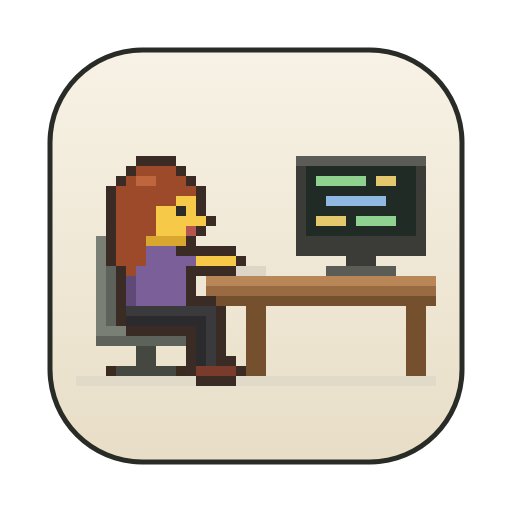
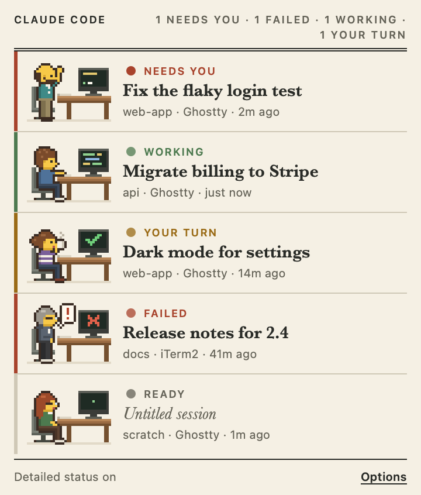
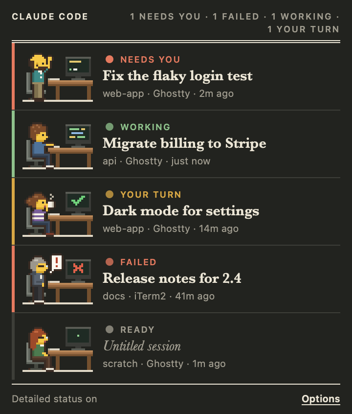

<p align="center"></p>

<h1 align="center">Pixel Workers Hub</h1>

<p align="center">Your Claude Code sessions in the macOS menu bar, each one a little pixel worker at a desk.<br>
Click one and you're in its Ghostty tab.</p>

<p align="center">
  
  
</p>

When you run several Claude Code sessions at once, it's easy to lose track of which one is waiting on a
permission prompt, which one finished ten minutes ago and which is still busy. Pixel Workers Hub sits in
your menu bar and shows all of them at a glance:

- **One row per open session**, named the way Claude Code names it, with its project folder and terminal.
- **A worker who acts out the status.** They type while Claude works, wave when it needs you, sip coffee
  when it's your turn and stand by a red ✕ when something failed.
- **A count beside the icon** when a session needs you (a permission prompt or a failure), so you notice
  without opening anything.
- **Click a row to jump to that session's tab.** Arrow keys and Return work too, and Esc closes the panel.

It needs no setup and no account, and makes no network requests. It reads what Claude Code already
reports about its own sessions.

## Built for Ghostty

Pixel Workers Hub was made for [Ghostty](https://ghostty.org) and works best there. It uses Ghostty's
AppleScript support (Ghostty **1.3 or later**) to find the tab Claude Code has titled with the session's
name and bring that exact tab forward, even across windows and splits.

Other terminals work too:

| Terminal | Clicking a session |
| --- | --- |
| **Ghostty 1.3+** | Focuses the session's own tab or split, matched by its title and folder |
| **iTerm2** | Focuses the session's own tab, matched exactly by its tty |
| **Terminal.app** | Focuses the session's own tab, matched exactly by its tty |
| **Anything else** (VS Code, Cursor, Warp, WezTerm, kitty…) | Brings that app to the front |
| **tmux / screen** | Looks for the session's tab in Ghostty by title |

## Install

**Requirements:** macOS 13 or later and [Claude Code](https://claude.com/claude-code). Recent versions
of Claude Code list their own sessions (`claude agents`), which is what the panel reads. Run
`claude update` if your sessions don't appear.

### Download

1. Get `Pixel-Workers-Hub.zip` from the [latest release](https://github.com/JensenWD/pixel-workers-hub/releases/latest).
2. Unzip it and drag **Pixel Workers Hub** into your Applications folder.
3. The app isn't notarized by Apple, so the first time, right-click it and choose **Open**, then **Open**
   again. If macOS says the app is damaged, run this once and open it again:
   ```sh
   xattr -dr com.apple.quarantine "/Applications/Pixel Workers Hub.app"
   ```

### Build it yourself

You only need Xcode's Command Line Tools (`xcode-select --install`). Full Xcode isn't required.

```sh
git clone https://github.com/JensenWD/pixel-workers-hub.git
cd pixel-workers-hub
make install
```

That builds the app, copies it to `/Applications` and opens it. Look for the pixel worker at a monitor in
your menu bar.

### First run

- **Click the icon** to open the panel. Right-click it (or use **Options** in the panel) for settings.
- **The first time you click a session**, macOS asks whether Pixel Workers Hub may control Ghostty (or
  iTerm2 or Terminal). Choose **Allow**. That permission is how it switches tabs. If you declined, turn it
  back on in **System Settings → Privacy & Security → Automation**.
- **Open at Login** in the Options menu keeps it in your menu bar after a restart.
- **Appearance** in the Options menu switches the panel from its light paper look to dark, or to follow
  your Mac's setting.

## Detailed status (optional)

On its own, Claude Code reports whether each session is busy, idle or waiting on a prompt, which covers
the essentials. Click **Turn on detailed status** at the bottom of the panel to add a few
[hooks](https://docs.claude.com/en/docs/claude-code/hooks) to `~/.claude/settings.json`. The panel then
also knows why a turn ended, and updates the moment anything happens instead of on its next look:

| Status | Meaning | Needs hooks |
| --- | --- | :---: |
| **Working** | Claude is working (with hooks: also while background tasks run) | |
| **Your turn** | Claude finished and is waiting for your next message | |
| **Needs you** | A permission prompt or a question is waiting for an answer | |
| **Failed** | The turn ended with an error, such as an API failure | ✓ |
| **Ready** | A new or cleared session that hasn't been given anything yet | ✓ |

Notes on the hooks:

- **What they record:** each hook writes one small file per session to
  `~/Library/Application Support/Pixel Workers Hub/sessions/`. It holds only the session ID, its status,
  the event name, a timestamp, the Claude process ID, the working folder and the session's title (the
  name Claude Code shows for it). Prompts, transcripts, tool inputs and outputs are never written.
- **Speed and safety:** the hook is the app's own binary. It runs in about 10 ms, prints nothing, always
  exits successfully and never blocks Claude.
- **Your settings:** your other settings and hooks are kept, in the same order. The file is written back
  with 2-space indentation. A backup of `settings.json` is saved next to the status files before every
  change. A `settings.json` linked in from a dotfiles folder is updated where it really lives.
- **Existing sessions:** sessions started after you turn this on report detailed status. Restart the ones
  already open to include them.
- **Turning it off:** click **Options → Detailed Status** again. That removes the hooks and the status files.

## Command line

The app binary has a few options, handy for scripting and troubleshooting:

```sh
APP="/Applications/Pixel Workers Hub.app/Contents/MacOS/PixelWorkersHub"
"$APP" --list            # the sessions the panel would show, as JSON
"$APP" --open 3f2a       # bring a session's tab forward (an ID prefix from --list will do)
"$APP" --install-hooks   # turn on detailed status
"$APP" --remove-hooks    # turn it off
```

`make hooks` and `make unhooks` do the same for the installed app.

## Troubleshooting

**No sessions show up.** Run the `--list` command above. If it can't find `claude`, apps opened from
Finder don't see your shell's `PATH`; point the app at it and quit and reopen:

```sh
defaults write io.github.jensenwd.pixel-workers-hub claudePath "$(command -v claude)"
```

**"No Ghostty tab is titled …".** Ghostty is matched by the tab title Claude Code sets, which is the
session's name. If your Ghostty config pins a fixed `title`, or a shell prompt rewrites titles while
Claude runs, the tab can't be found. Unnamed sessions are matched when they're the only Claude tab in
their folder. Naming a session (`/rename` in Claude Code) makes the match exact.

**Clicking does nothing, or says macOS blocked it.** Allow Pixel Workers Hub under
**System Settings → Privacy & Security → Automation**. If you built the app yourself, each rebuild gets a
new signature, and macOS may ask again.

**You use `CLAUDE_CONFIG_DIR`.** Apps opened from Finder don't see variables set in your shell, so the
hooks go into `~/.claude/settings.json`. Run `"$APP" --install-hooks` from a terminal where the variable
is set instead.

**Detailed status stopped working after moving the app.** The hooks run the app from where it was when
you turned them on. If that copy is gone, the app repairs the hooks the next time it opens. Otherwise,
turn detailed status off and on again.

## Uninstall

```sh
make uninstall
```

This removes the hooks, quits the app and deletes it from `/Applications`. If you downloaded the app
instead, turn off **Detailed Status** from the Options menu first, then quit the app and move it to the Trash.

## How it works

- **The session list** comes from `claude agents --json`, Claude Code's own list of what's running. It's
  polled every 3 seconds while the panel is open and every 20 seconds otherwise.
- **The hooks' status files** are watched, so a permission prompt or a finished turn shows the moment it
  happens, with no polling. Whichever is newer wins: a hook that fired after the last look decides, and
  the next look overrules a hook that didn't fire. That's how a prompt dismissed with Esc, which fires no
  hook, still clears. On versions of Claude Code from before
  `claude agents`, the status files alone list the sessions.
- **Finding the tab:** the terminal is found by walking up from the Claude process to the app that
  started it. Ghostty tabs are matched by title and folder. iTerm2 and Terminal tabs are matched by tty.
- **The panel** is a small web page (`Web/`) in a native popover. The pixel art is drawn as SVG from text
  grids in `Web/sprites.js`. Each session keeps the same worker while the app runs, and a new session
  never dresses like someone already at a desk.

```
Sources/PixelWorkersCore/   sessions, hook recorder, hook installer, terminal focusing (tested)
Sources/PixelWorkersHub/    the menu-bar app: status item, popover, polling
Web/                        the panel page and the sprites
Support/                    Info.plist and the app icon
scripts/                    build, icon and screenshot scripts
```

## Development

```sh
make run          # run from source, without bundling
make test         # unit tests (needs full Xcode for XCTest)
make app          # build "build/Pixel Workers Hub.app"
make icon         # redraw the app icon from the sprites
make screenshot   # redraw the README screenshots from made-up sessions
```

Releases are built by GitHub Actions when a `v*` tag is pushed. Those builds are universal, for Apple
silicon and Intel.

## License

[MIT](LICENSE)
